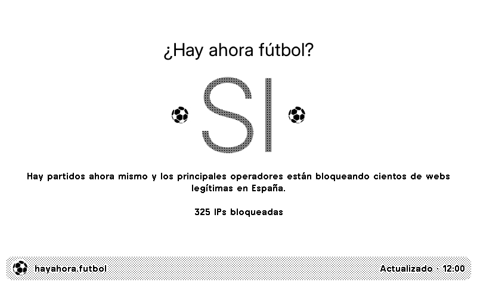

# ¿Hay ahora fútbol?

See whether the mass IP blocking associated with Spanish football matches is active, straight from your TRMNL. A clear yes or no, with the blocked IP count in the title bar.

<a href="https://trmnl.com/recipes/294074"></a>

[Install on TRMNL](https://trmnl.com/recipes/294074)



[All layout previews](TRMNL/README.md#previews).

## Settings

- **Language:** Spanish or English (defaults to Spanish).
- No account or API key needed.

Full, half horizontal, half vertical and quadrant layouts support TRMNL OG, BWRY and TRMNL X, including portrait. Active blocking gets a red accent on BWRY and remains readable in grayscale. Data refreshes every 15 minutes.

The plugin reads [hayahora.futbol](https://hayahora.futbol/)'s public `blocked.dns.hayahora.futbol` signal through Google DNS. More than ten returned addresses means active blocking; smaller answer sets and `NXDOMAIN` mean inactive. This is the source's signal, not a test of your own connection.

## Develop locally

Install [trmnlp](https://github.com/usetrmnl/trmnlp), then run from the repository root:

```sh
cd TRMNL
trmnlp serve
```

Templates and settings live in [TRMNL/src/](TRMNL/src/); see the [plugin guide](TRMNL/README.md) for setup and layout details.

[Questions or ideas?](https://github.com/taichikuji/trmnl-laliga-plugin/issues) · [License](LICENSE)
